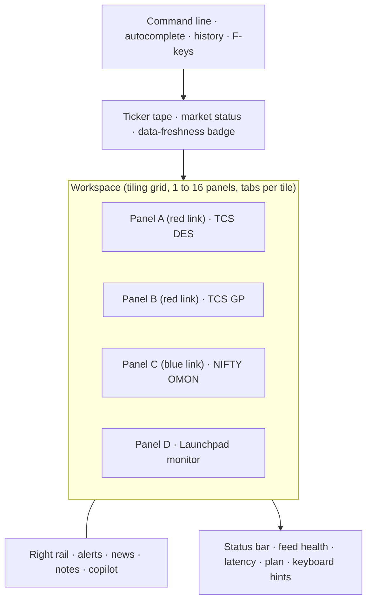
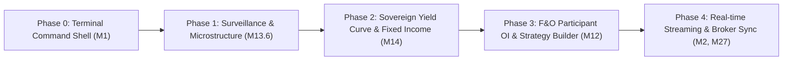

# Arthdex Terminal: product requirements (end to end)

| | |
|---|---|
| Status | Draft v1 for the owner's review |
| Date | 6 November 2026 |
| Builds on | `docs/prd-remaining-work.md` (workstreams W1 to W13), `docs/paid-feed-roadmap.md`, `docs/data-sources.md`, `docs/data-integrity-and-limitations.md` |
| Scope | Every feature, update and addition needed to make Arthdex the best Indian market research platform, at Bloomberg Terminal level or better for Indian markets |

> [!IMPORTANT]
> This PRD **extends** the existing W1–W13 plan; it does not replace it. Every earlier item is kept and mapped to a module here (the "Absorbs" column). New items carry new IDs. Wherever a feature depends on a licence, a paid feed or a legal opinion, this document says so. **Nothing here relaxes the rule that every figure comes from real data.**

---

## Contents

1. Vision and positioning
2. Where Arthdex stands today (evidence-based audit)
3. Benchmark: Bloomberg and Indian competitors
4. Users and jobs to be done
5. Product principles (acceptance conditions)
6. The terminal shell: information architecture and interaction model
7. Feature modules M1–M33 (requirements, data, acceptance, dependencies)
8. Non-functional requirements
9. Data sources and licensing matrix
10. Target architecture
11. Phased roadmap and milestones
12. Success metrics
13. Risks and mitigations
14. Decisions only the owner can take
15. Appendix A: Bloomberg function to Arthdex command map
16. Appendix B: India-specific datasets Bloomberg covers poorly

---

## 1. Vision and positioning

**Vision.** The workstation that any serious participant in Indian markets opens first in the morning and closes last at night: a long-term investor, an F&O trader, a PMS or mutual fund analyst, a SEBI-registered research analyst, or a corporate treasury desk.

**Positioning.** Bloomberg covers every market in the world at roughly US\$30,000 per seat per year, but its Indian depth is thin. It has little on promoter pledges, SAST disclosures, ASM/GSM surveillance, delivery percentages, SME IPOs, unlisted shares, CAS-based portfolios, Indian tax, monthly sector data (SIAM, TRAI, DGCA, CEA) or regional languages. Indian retail tools such as Screener.in, Tickertape, Trendlyne, Sensibull, StockEdge and ChartInk are each strong in one area, but none of them is a terminal. **Arthdex should combine Bloomberg's interaction model (commands, linked panels, keyboard-first use, every asset class, Excel and API access) with Indian data depth that no global vendor has, at a retail-to-prosumer price.**

**Five pillars.**

| Pillar | What it means | Bloomberg equivalent |
|---|---|---|
| 1. One command line | Every screen is a function reachable by typing, for example `RELIANCE DES`, `NIFTY OMON`, `ECO`, `GC IN` | `<GO>` command system |
| 2. Every Indian dataset, vetted | Exchange, regulator and ministry data, each with a second source or a single-source label | Bloomberg data plus BI research |
| 3. Every asset class | Equities, F&O, bonds, money markets, FX, commodities, funds, unlisted, macro | Multi-asset terminal |
| 4. From idea to portfolio | Screen, research, value, chart, test, alert, track, tax | EQS → DES/FA → BTST → PORT |
| 5. Open and programmable | Excel and Sheets functions, REST and WebSocket API, Python SDK, AI copilot that cites its sources | BDP/BDH, BQL, BQuant |

---

## 2. Where Arthdex stands today (evidence-based audit)

Checked against the repository on 6 November 2026 (`main` @ `b7f8a2b`, CI green, 124 backend tests, 36 routes).

### 2.1 Built and working

| Area | What exists | Where |
|---|---|---|
| Company research | Masthead; 11 tabs (overview, statistics, analysts, statements, history, shareholders, technicals, order flow, research dossier, quant engine, macro and news); peers; P/E band; Piotroski, Altman and Beneish checks; reverse DCF | `app/company/[symbol]/*`, `components/company/*`, `backend/app/services/forensics.py`, `peers.py` |
| Markets | Live cockpit, market watch (movers, Nifty 500 treemap, flows, RRG, factor screens), bhavcopy and delivery scanner, deals, calendar, results season, IPO, commodities (global benchmarks) | `app/live`, `app/market-watch`, `app/bhavcopy`, `app/results`, `app/ipo`, `app/commodities` |
| Derivatives | Index and stock option chains with Greeks, three views (core chain, full Greeks, strike walls), F&O build-up, F&O ban tracker, earnings-implied moves | `components/derivatives/*`, `backend/app/services/options.py`, `fno_ban.py` |
| Quant | Volatility ensemble, VaR/ES, Merton distance to default, Markov regime, conformal forecasts, scenario forecast cockpit | `components/quant/*`, `backend/app/services/quant.py`, `scenario_forecast.py` |
| Research engine | Event-impact analyzer (event study, synthetic control, SDID, FinBERT and GoEmotions), compare, PDF and Excel export | `backend/ceia/*`, `app/analyzer/*` |
| Screening | Fundamental screener with a formula language on vetted figures; MACD crossover screener | `backend/app/services/fundamental_screen.py`, `components/screener/*` |
| Portfolio | XIRR (Newton with bisection), sector allocation, Section 112A tax-loss harvesting | `backend/app/services/portfolio_analytics.py`, `components/portfolio/portfolio-terminal.tsx` |
| Trust layer | Second source per company feed, NSE XBRL settles disputes, watchdog every 30 minutes, daily reconciliation, provenance lines on every panel | `financial_sources.py`, `quote_sources.py`, `watchdog.py`, `reconcile.py` |
| Shell | Bloomberg-style dense design system, ticker tape, keyboard HUD, global shortcuts, contrast toggle, universal search | `components/layout/*`, `components/ui/*`, `components/search/*` |

### 2.2 Gaps that block "Bloomberg-class" (verified in code)

| # | Gap | Evidence | Severity |
|---|---|---|---|
| G1 | **No user accounts.** Watchlists, alerts and logged calls live in browser storage | `lib/client/use-local-store.ts`, `lib/client/watchlist.ts`; no auth routes | Critical |
| G2 | **No real-time data and no streaming.** All data is delayed or end-of-day (public NSE, Yahoo); there is no WebSocket or SSE anywhere | grep for `WebSocket`/`EventSource` returns nothing | Critical |
| G3 | **No command line or multi-panel workspace.** Pages are separate routes; panels cannot be linked, tiled or saved | `components/layout/global-terminal-shortcuts.tsx` covers navigation only | Critical |
| G4 | **No BSE coverage.** About 1,500 BSE-only companies and BSE announcements are missing | no `bseindia` reference in `backend/app` | High |
| G5 | **Order flow page defaults to US futures (NQ).** GEX uses SPY/QQQ proxies. This is off-mission for an India-first terminal | `app/orderflow/page.tsx` line 107; `options_gex.py` | High |
| G6 | **Commodities are COMEX/NYMEX, not MCX/NCDEX** | `backend/app/services/commodities.py` line 5 | High |
| G7 | **No fixed income, money market, FX, mutual fund, ETF or macro modules** | no routes, providers or services | Critical |
| G8 | **No real charting engine.** Charts are custom SVG; no drawing tools, multi-pane or saved layouts | `components/company/price-chart.tsx`, `components/technicals/indicator-chart.tsx` | High |
| G9 | **Statements tab is single-source (Yahoo)** and stale for some companies | `docs/prd-remaining-work.md` W13.5 | High |
| G10 | **No consensus estimates** beyond Yahoo's analyst tab | `components/yahoo/analysts-view.tsx` | High |
| G11 | **Portfolio has no persistence, CAS import, corporate actions or ITR report** | `portfolio-terminal.tsx` runs on session holdings | High |
| G12 | **No options strategy builder, IV surface or IV rank** | absent | High |
| G13 | **No Excel add-in, public API or SDK for users** | absent | Medium |
| G14 | **No AI copilot** (owner deferred, D5) | absent | Medium |
| G15 | **Unlisted prices are hand-maintained** | `data/unlisted.json` | Medium |
| G16 | **Point-in-time history starts on 3 November 2026**, which limits honest backtests | `backend/app/store.py` | Medium |
| G17 | **No ASM/GSM surveillance, T2T, circuit band changes or SLB data** | absent | Medium |
| G18 | **8 React Compiler warnings remain** | `live-volume-profile.tsx`, `scenario-forecast-cockpit.tsx`, `microstructure-cvd-panel.tsx`, `macro-market-radar.tsx` | Low |
| G19 | **No legal, billing or plan gating** | absent; D3 and D4 open | Critical before charging |

---

## 3. Benchmark: Bloomberg and Indian competitors

### 3.1 Capability matrix

Legend: ● strong, ◐ partial, ○ absent.

| Capability | Bloomberg | Best Indian tool | Arthdex today | Arthdex target |
|---|---|---|---|---|
| Command line and function codes | ● | ○ | ○ | ● M1 |
| Multi-panel linked workspaces | ● | ◐ TradingView | ○ | ● M1 |
| Real-time Indian quotes and depth | ● | ● brokers | ○ | ● M2 (licensed) |
| Company fundamentals, 10+ years, standardised | ● | ● Screener.in | ◐ | ● M4 |
| Indian filings depth (XBRL, SAST, pledge, PIT) | ◐ | ◐ Trendlyne | ◐ | ● M7, M8 |
| Consensus estimates and revisions | ● | ◐ Trendlyne | ○ | ● M5 (paid feed) |
| Earnings-call transcripts and AI summaries | ● | ◐ | ○ | ● M8, M24 |
| Screening (fundamental and technical) | ● EQS | ● ChartInk, Screener.in | ◐ | ● M10 |
| Charting | ● | ● TradingView | ◐ | ● M11 |
| Options analytics and strategy builder | ● OMON/OVME | ● Sensibull, Opstra | ◐ | ● M12 |
| Market monitors and breadth | ● | ◐ StockEdge | ◐ | ● M13 |
| Indian bonds, yield curve, RBI path | ● | ○ | ○ | ● M14 |
| FX (INR) | ● | ◐ | ○ | ● M15 |
| MCX and NCDEX commodities | ◐ | ◐ | ○ | ● M16 |
| Mutual funds, ETFs, PMS, AIF | ◐ | ● Value Research | ○ | ● M17 |
| Indian macro and release calendar | ● | ◐ | ○ | ● M18 |
| Monthly sector KPIs (auto, telecom, power, aviation) | ◐ | ◐ | ○ | ● M19 |
| IPO, SME, unlisted, pre-IPO | ◐ | ◐ | ◐ | ● M20 |
| Portfolio analytics and Indian tax | ● PORT | ◐ | ◐ | ● M21 |
| Risk, factor and backtesting lab | ● MARS, BTST | ○ | ◐ | ● M22 |
| Alerts on events | ● | ◐ | ◐ | ● M23 |
| AI copilot citing sources | ● | ○ | ○ | ● M24 |
| Collaboration and chat | ● IB | ○ | ○ | ◐ M25 |
| Excel functions and API | ● BDP/BDH, BQL | ○ | ○ | ● M26 |
| Broker integration and paper trading | ● EMSX | ● brokers | ○ | ● M27 |
| Hindi and regional languages | ○ | ◐ | ○ | ● M30 |
| Price | ~US\$30k/seat/yr | ₹0–₹10k/yr | free | Freemium to pro (M29) |

### 3.2 Where Arthdex can beat Bloomberg for Indian users

1. **Regulatory depth.** Promoter pledge history, SAST and PIT trades, ASM/GSM stage changes, F&O ban and MWPL, delivery percentage, related-party transactions, auditor resignations and NCLT cases, all linked to the source filing.
2. **Data honesty.** Second-source vetting and visible provenance on every figure. Bloomberg rarely shows disagreements between sources.
3. **Indian portfolio reality.** CAS import, Section 112A grandfathering, ITR-ready capital gains, dividend TDS, SIP XIRR.
4. **Monthly sector data** that Indian analysts track by hand in spreadsheets.
5. **Retail-to-prosumer price and phone-first use**, with Hindi and regional languages.
6. **Unlisted and pre-IPO coverage** with price history and a research dossier.

---

## 4. Users and jobs to be done

| Persona | Share at launch | Jobs to be done | Must-have modules |
|---|---|---|---|
| P1 Long-term investor | 40% | Find good businesses at fair prices; understand a company in 10 minutes; track holdings and tax | M3–M8, M10, M17, M21, M23 |
| P2 Active F&O trader | 30% | Read the day; find setups; build and manage option positions; journal | M2, M11–M13, M22, M27 |
| P3 Professional analyst (PMS, AIF, MF, broker research, SEBI RA) | 15% | Build models fast; track a coverage list; export to Excel; write reports | M1, M4–M8, M19, M24–M26 |
| P4 Treasury and fixed income desk (corporates, NBFCs, cooperative banks) | 5% | Track G-sec and T-bill yields, the RBI path, liquidity, ratings | M14, M15, M18 |
| P5 Founder, CFO or IR | 5% | Track own stock, peers, holders and analyst sentiment | M3, M7, M8, M23 |
| P6 Student or learner | 5% | Learn markets with real data | M28, free tier |

**North-star job:** "I can go from a question to a defensible, sourced answer about any Indian security, fund or macro series in under 60 seconds, without leaving Arthdex."

---

## 5. Product principles (acceptance conditions for every feature)

The seven principles in `docs/prd-remaining-work.md` §2 still apply (accuracy gate, nine-gate pipeline, point-in-time, blank is not zero, design system, upstream load, informational not advisory). Added here:

| # | Principle | Test |
|---|---|---|
| P8 | **Everything is a function.** Every screen has a command mnemonic and a URL, and can open in a panel | The command palette resolves every route |
| P9 | **Every number is clickable and explainable.** A click shows its definition, formula, source, timestamp and second source | Provenance popover on 100% of figures (W10.3) |
| P10 | **Keyboard first, mouse optional.** Every action has a shortcut; tables navigate with arrow keys | An analyst can complete the 10 core flows without a mouse |
| P11 | **Latency budgets are requirements.** See §8 | Measured in CI (Lighthouse) and in production (RUM) |
| P12 | **India first.** Defaults are NSE, IST, INR, lakh and crore, the Indian fiscal year and Indian tax rules | No default view opens on a foreign instrument (fixes G5) |
| P13 | **Licensed before live.** No real-time exchange data is shown until the vendor agreement is signed | Real-time flag driven by a licence setting, not by code paths |
| P14 | **The model is labelled as a model.** Estimated, modelled or AI-generated content carries a visible label and a method link | Lint rule or test on the label component |
| P15 | **No silent fallbacks.** If the primary source fails, the panel says which backup it used | Watchdog plus provenance line |

---

## 6. The terminal shell: information architecture and interaction model

### 6.1 Concepts

| Concept | Definition |
|---|---|
| **Security context** | The instrument currently loaded in a panel: equity, index, future, option, bond, fund, currency pair, commodity, macro series or portfolio. Typed by a yellow-key style prefix: `EQ`, `IX`, `FUT`, `OPT`, `GOV`, `CORP`, `MF`, `FX`, `CMDTY`, `ECO`, `PORT` |
| **Function** | A screen that acts on the context, for example `DES`, `FA`, `GP`, `OMON` |
| **Command** | `<security> <function>` followed by Enter, for example `TCS IN EQ FA`, `NIFTY IX OMON`, `IN10Y GOV GP`, `USDINR FX GP`. Short forms resolve automatically (`TCS FA`) |
| **Panel** | One function in one context. Panels tile in a workspace |
| **Link group** | Panels sharing a colour follow each other: change the security in one and the others update (Bloomberg's linked windows) |
| **Workspace** | A saved arrangement of panels, link groups and settings, synced to the account and shareable by link |
| **Launchpad** | A user-built monitor page of small widgets (quote boards, news, charts, alerts) |

### 6.2 Layout

### 6.3 Requirements for the shell are module M1 below.

### 6.4 Navigation map (top-level menus, each also a command)

| Menu | Functions |
|---|---|
| Markets | `MKT` overview, `MOST` movers, `BRDT` breadth, `HMAP` heatmaps, `SECT` sectors, `RRG`, `FLOW` institutional flows, `SURV` surveillance, `BHAV`, `DEAL` |
| Equity | `DES`, `FA`, `EE`, `ANR`, `RV`, `VAL`, `HDS`, `PLDG`, `INSD`, `MGMT`, `CF`, `CACS`, `DVD`, `ERN`, `EVTS`, `SPLC`, `TECH`, `QNT` |
| Derivatives | `OMON`, `OSB` strategy builder, `OVDV` vol surface, `OIA` OI analytics, `FNOB` ban list, `ROLL` rollover, `PART` participant OI, `IVR` IV rank |
| Fixed income | `GC IN` yield curve, `GSEC`, `SDL`, `TBIL`, `CORP`, `CRPR` ratings, `RBIP` RBI path, `LIQ` liquidity |
| FX | `FXM` monitor, `USDINR GP`, `FRR` FBIL reference rates, `RES` forex reserves |
| Commodities | `CMKT` MCX/NCDEX monitor, `CMDTY GP`, `SPRD` spreads, `SEAS` seasonality |
| Funds | `MF`, `MFS` fund screener, `MFH` holdings, `OVLP` overlap, `ETF`, `PMS`, `AIF` |
| Economy | `ECO` calendar, `ECST` India statistics, `ECWB` world, `SKPI` sector KPIs |
| Primary market | `IPO`, `SME`, `UNL` unlisted, `QIP`, `OFS`, `BUYB`, `OPEN` open offers, `DLST` delisting |
| Research | `EQS` screener, `TSCN` technical scanner, `THEM` themes, `GRP` business groups, `SMRT` smart money, `BTST` backtest, `FCTR` factors, `CORR`, `STRS` stress |
| Portfolio | `PORT`, `PRTU` upload, `TAX`, `DIVC` dividend calendar, `JRNL` journal, `PAPR` paper trading |
| News | `TOP`, `N`, `CN` company news, `FIL` filings, `NSRC` news search |
| Tools | `ALRT`, `NOTE`, `XLS` Excel, `API`, `ASK` copilot, `HELP`, `LEARN`, `FLDS` data dictionary |

---

## 7. Feature modules

Each module lists a goal, a benchmark, requirements, data, acceptance criteria and dependencies.

**Priority:** P0 is needed for a credible terminal. P1 brings parity with the best tool in that area. P2 differentiates. P3 is later.
**Size** (one engineer): S is up to 3 days, M up to 2 weeks, L 2 to 6 weeks, XL over 6 weeks.

---

### M1. Terminal shell and command system

**Goal.** One keyboard-driven surface for all functions, with linked multi-panel workspaces.
**Benchmark.** Bloomberg `<GO>`, Launchpad and linked windows; TradingView multi-chart layouts.

| ID | Requirement | Pri | Size |
|---|---|---|---|
| M1.1 | Command line always focused by `/` or backtick; parses `<security> [<type>] <function>`; fuzzy-autocompletes securities (NSE, BSE, indices, funds, bonds) and functions, showing type and exchange | P0 | L |
| M1.2 | Function registry (`lib/terminal/functions.ts`): code, name, description, accepted context types, route, panel component, required plan, keyboard alias. One source of truth for the command line, menus, help and the sitemap | P0 | M |
| M1.3 | Tiling workspace: split horizontally or vertically, resize, maximise (`Ctrl+Enter`), tabs inside a tile, close, drag to rearrange; 1 to 16 panels; minimum panel 320×200 px | P0 | XL |
| M1.4 | Link groups (6 colours plus unlinked): changing the security in one panel broadcasts to its group | P0 | M |
| M1.5 | Saved workspaces: name, save, duplicate, set default, share as a read-only link; synced to the account (needs M29) | P0 | M |
| M1.6 | Starter workspaces: "Morning briefing", "F&O desk", "Company deep dive", "Macro and rates", "Portfolio review" | P1 | S |
| M1.7 | Pop-out panels into a new browser window that stays linked (BroadcastChannel) for multi-monitor setups | P1 | M |
| M1.8 | Command history (↑/↓) and favourites; F-key bindings (F2 news, F3 alerts, F8 portfolio, F9 copilot, F11 full screen) | P1 | S |
| M1.9 | Launchpad monitors: widget grid with quote boards (user columns), mini charts, news by filter, alert stream, economic calendar, notes | P1 | L |
| M1.10 | Right rail: alerts, news, notes and copilot, collapsible, keyboard toggles | P1 | M |
| M1.11 | Status bar: feed health per source, last tick time, data mode (real-time, delayed or end-of-day), plan, latency | P0 | S |
| M1.12 | `HELP <function>` and a `?` overlay listing shortcuts for the focused panel | P0 | S |
| M1.13 | Every function also works as a full-page route (SEO, sharing, phones); panel and page share one component | P0 | M |
| M1.14 | Theme presets: Terminal Dark (amber on black), Terminal Light, High Contrast; font scale 85–130% | P1 | S |
| M1.15 | Phone mode: a single panel with a swipe stack, the command line as a search sheet, and the bottom navigation | P0 | M |

**Data.** None (a UI layer over existing endpoints).
**Acceptance.** All existing 36 routes are reachable by command. A 4-panel linked workspace (DES, GP, HDS, CN) updates every panel within 300 ms of a security change. A workspace saved on desktop opens identically on another device. Ten core flows complete with the keyboard only.
**Dependencies.** M29 (accounts) for sync; M2 for live updates inside panels.

---

### M2. Real-time market data and streaming

**Goal.** Licensed live data for NSE and BSE cash, F&O, currency and MCX, streamed to the browser, with honest fallbacks.
**Benchmark.** Bloomberg real-time; broker terminals (Kite, Dhan).

| ID | Requirement | Pri | Size |
|---|---|---|---|
| M2.1 | Choose and sign a licensed vendor for NSE and BSE real-time and delayed redistribution (authorised data vendors such as TrueData, Global Datafeeds or Accelpix, or NSE directly). Record the licence terms in `docs/data-licences.md` (D9) | P0 | external |
| M2.2 | Ingestion service (`backend/stream/`): vendor WebSocket to normalised ticks (LTP, volume, OI, bid/ask, depth 5) to an internal bus (Redis Streams or NATS) | P0 | L |
| M2.3 | Fan-out gateway: WebSocket endpoint `/ws` with per-user subscriptions (symbols × channels: quote, depth, OI, trades), throttled at 4 updates per second per symbol for the browser, with entitlement checks per plan | P0 | L |
| M2.4 | Client store (`lib/stream/`): one shared socket, reference-counted subscriptions, reconnect with backoff, stale marker after 5 s without a tick | P0 | M |
| M2.5 | Tick and bar storage: 1-second and 1-minute bars in a time-series database (TimescaleDB or ClickHouse); EOD bhavcopy remains the settlement source of record | P0 | L |
| M2.6 | Delayed mode for free users (15 minutes) and end-of-day mode when the licence lapses, both switched by entitlement | P0 | M |
| M2.7 | Market depth (5 levels, 20 where licensed) panel `DPTH` with cumulative bars | P1 | M |
| M2.8 | Time and sales `TAS` with trade size filter and large-print highlights | P1 | M |
| M2.9 | Market status service: pre-open (09:00–09:15), normal, closing, post-close, holidays (NSE calendar), special sessions (Muhurat), and surveillance halts | P0 | S |
| M2.10 | Replace the US futures default on `/orderflow` with NIFTY and BANKNIFTY futures and real tape once M2.2 runs (closes G5); keep US futures as an opt-in instrument | P0 | S |
| M2.11 | Index values in real time under an NSE Indices licence (or BSE for Sensex) | P0 | external |
| M2.12 | Order-flow upgrade: real delta, CVD and footprint from tape; Lee-Ready classification where the feed has no aggressor flag, labelled "classified" (`paid-feed-roadmap.md` items 1–5) | P1 | L |
| M2.13 | Depth recorder for a liquidity heatmap (history builds forward from the recording start date) | P2 | L |

**Absorbs.** Paid-feed roadmap items 1–9; W7.5 prerequisites.
**Acceptance.** Tick to browser p95 under 500 ms within India. 5,000 concurrent sockets per gateway node. Gap detection and backfill from the vendor on reconnect. Free users never receive data less than 15 minutes old (tested).
**Risks.** Redistribution fees scale with users; budget per tier (D9). Cloud IPs blocked by NSE matter only for scraped endpoints, not for licensed feeds.

---

### M3. Security description and company page (DES)

**Goal.** The most complete company page in India, readable in 10 minutes.
**Benchmark.** Bloomberg DES, RELS, MGMT; Screener.in; Tickertape.

| ID | Requirement | Pri | Size |
|---|---|---|---|
| M3.1 | `DES` summary: business description, segments, key metrics strip, 52-week range, market cap rank in sector, index memberships, F&O eligibility, lot size, surveillance status (ASM/GSM/T2T), circuit band, face value, ISIN, BSE and NSE codes | P0 | M |
| M3.2 | Add BSE as an exchange: BSE quotes, BSE-only companies (about 1,500), BSE announcements and BSE scrip codes; dual listing reconciliation (closes G4) | P0 | L |
| M3.3 | Corporate identity: CIN, registered office, incorporation date, group, auditor, registrar (RTA), listing date; from MCA master data and exchange filings | P1 | M |
| M3.4 | `RELS` related securities: futures, options, ADR/GDR, bonds and NCDs issued, subsidiaries that are listed, parent | P1 | M |
| M3.5 | Key events strip: next results date, AGM, record dates, board meetings, lock-in expiries, index inclusion or exclusion | P0 | S |
| M3.6 | Company page summary in plain language ("What changed this quarter"), generated from vetted figures and labelled (needs M24 for prose; rule-based first) | P1 | M |
| M3.7 | Option chain summary card on F&O stocks (W4.14) | P1 | S |
| M3.8 | Private notes and thesis tracker per company (W4.15, needs M29) | P1 | S |
| M3.9 | Peer charts: any metric over time against chosen peers (W4.13) | P1 | S |
| M3.10 | Price performance table: 1D, 1W, 1M, 3M, 6M, YTD, 1Y, 3Y, 5Y, 10Y, against Nifty 50, sector index and peers, total return including dividends | P0 | S |

**Absorbs.** W4.13, W4.14, W4.15.
**Acceptance.** For 50 test companies, every DES field is filled or shows a dash with a reason. BSE-only companies such as small SME listings have a full page.

---

### M4. Financials database (FA)

**Goal.** Standardised, as-reported, point-in-time statements for every listed company, 10 to 20 years deep.
**Benchmark.** Bloomberg FA; CMIE Prowess; ACE Equity; Screener.in.

| ID | Requirement | Pri | Size |
|---|---|---|---|
| M4.1 | Full statements from NSE and BSE XBRL: every line of P&L, balance sheet and cash flow, as filed, standalone and consolidated; separate templates for general, bank, NBFC and insurance (W4.1) | P0 | XL |
| M4.2 | Standardised view: Arthdex canonical lines mapped from Ind-AS elements, with the as-reported view one click away; every mapped total foots | P0 | L |
| M4.3 | History: 10-year annual and 40-quarter history; pre-XBRL years from annual-report PDFs, labelled by source (W4.3) | P0 | L |
| M4.4 | Point-in-time: each figure stored with its filing date and any restatement as a new version; "as known on date" toggle | P0 | M |
| M4.5 | Ratios: 80+ ratios (profitability, efficiency, liquidity, leverage, cash conversion, per share, DuPont), each with a formula in the data dictionary | P0 | M |
| M4.6 | Segment and geography breakdown (W4.2) | P1 | M |
| M4.7 | Bank and NBFC KPIs: NIM, CASA, GNPA, NNPA, PCR, CRAR, credit cost, slippages, AUM and disbursements, from investor presentations and XBRL | P1 | L |
| M4.8 | Insurance KPIs: VNB, VNB margin, APE, embedded value, persistency, combined ratio, solvency | P2 | M |
| M4.9 | Cash flow summary on the overview (W4.4) | P0 | S |
| M4.10 | Export any statement to Excel with formulas; copy table with formatting | P0 | S |
| M4.11 | Common-size and growth views; CAGR over chosen windows | P0 | S |
| M4.12 | Quarterly results tracker: results within minutes of filing, with year-on-year and quarter-on-quarter change and the surprise against consensus (M5) | P0 | M |

**Absorbs.** W4.1–W4.4, W13.3, W13.5, W13.7.
**Data.** NSE and BSE XBRL (free); annual reports (company sites, free to link and parse); screener.in as cross-check (check terms).
**Acceptance.** For 100 companies across formats, standardised totals foot and match vetted headlines within 0.5%. Results filed during market hours appear within 10 minutes. Restatements show both versions.

---

### M5. Estimates, consensus and analyst research (EE, ANR)

**Goal.** Consensus forecasts, revisions and targets, plus a library of broker research where licensed.
**Benchmark.** Bloomberg EE, ANR, BRC; Trendlyne forecasts.

| ID | Requirement | Pri | Size |
|---|---|---|---|
| M5.1 | License a consensus estimates feed for Indian equities (revenue, EBITDA, PAT, EPS for FY+1 to FY+3, target price, rating counts) (D6) | P0 | external |
| M5.2 | `EE`: consensus, high, low, number of estimates, standard deviation, revision trend at 1, 3 and 6 months | P0 | M |
| M5.3 | `ANR`: ratings distribution over time, target price range against price, upgrades and downgrades log | P0 | M |
| M5.4 | Earnings surprise history (`ERN`) with the price reaction on day 0 and day 5 (abnormal return from the event engine) | P1 | M |
| M5.5 | Estimate revision screener: biggest upward and downward revisions this week | P1 | S |
| M5.6 | Broker research library: links to public research reports (where brokers publish them) with metadata; no redistribution of paid reports | P2 | M |
| M5.7 | Arthdex's own model estimates (time-series and fundamental), always labelled as model output and never mixed with consensus | P2 | L |

**Absorbs.** W6.9, W10.5.
**Acceptance.** Consensus matches the vendor to the decimal. Every estimate shows its as-of date and count.
**Risks.** Licence cost; SEBI RA questions if Arthdex publishes its own targets (D4).

---

### M6. Valuation tools (RV, VAL)

**Goal.** Interactive valuation that a professional would trust, with inputs from the vetted database.
**Benchmark.** Bloomberg RV, DCF templates; Indian sell-side models.

| ID | Requirement | Pri | Size |
|---|---|---|---|
| M6.1 | `RV` relative valuation: peer table of P/E, P/B, EV/EBITDA, EV/Sales, PEG, dividend yield, ROE, growth (trailing and forward), with median, percentile and z-score | P0 | M |
| M6.2 | Valuation bands: P/E, P/B, EV/EBITDA over 5 and 10 years with mean and ±1 and ±2 standard deviation bands (W4.5) | P0 | S |
| M6.3 | Editable DCF: FCFF and FCFE, 3-stage, WACC builder (10-year G-sec from M14, beta from M22, ERP setting), sensitivity table, scenario presets (W4.6) | P0 | L |
| M6.4 | Reverse DCF linked to the DCF inputs (exists; connect) | P0 | S |
| M6.5 | Sum of the parts for conglomerates and holding companies: listed subsidiaries at market value with a holding-company discount input | P1 | M |
| M6.6 | Bank valuation: justified P/B from ROE, cost of equity and growth; residual income model | P1 | M |
| M6.7 | Save, version and share models; export to Excel with live formulas (needs M29, M26) | P1 | M |
| M6.8 | Historical valuation of the sector and the index (Nifty P/E, P/B and dividend yield since 1999 from NSE) | P1 | S |

**Acceptance.** DCF output matches a reference spreadsheet to 0.01% for three test companies. Every input shows its source.

---

### M7. Ownership, insiders and governance (HDS, PLDG, INSD, MGMT, ESG)

**Goal.** Who owns what, who is buying or selling, and how well the company is governed, from filings.
**Benchmark.** Bloomberg HDS, PHDC, MGMT, ESG; Trendlyne superstar portfolios.

| ID | Requirement | Pri | Size |
|---|---|---|---|
| M7.1 | Shareholding pattern history (promoter, FII, DII, MF, insurance, retail, others) for 20+ quarters, with change bars | P0 | S (exists, extend) |
| M7.2 | Named holders above 1% each quarter, and mutual fund holdings each month from AMFI-mandated portfolio disclosures (W4.8, W6.8) | P0 | L |
| M7.3 | `PHDC` holder view: everything one investor or fund holds, with changes (well-known investors, W6.7) | P1 | M |
| M7.4 | Promoter pledge history, encumbrance and invocations, with alerts (exists; extend with invocation and NDU events) | P0 | S |
| M7.5 | Insider and SAST trades (`INSD`): every PIT and SAST disclosure, aggregated by person and company, with net buying screens (W6.6) | P0 | M |
| M7.6 | Bulk and block deals history per company and per client name | P0 | S (exists, extend) |
| M7.7 | Management and board (`MGMT`): directors, KMPs, tenure, other directorships, remuneration, attendance, from annual reports and MCA (W4.9) | P1 | L |
| M7.8 | Auditor history, auditor resignations with reasons, qualified opinions, CARO remarks | P1 | M |
| M7.9 | Related-party transactions (half-yearly RPT filings), as a share of revenue and of net worth | P1 | M |
| M7.10 | Red-flag panel: pledge rising, auditor change, RPT spike, contingent liabilities, frequent dilution, promoter selling, ASM/GSM entry, delayed filings, credit rating downgrade (W4.7) | P0 | M |
| M7.11 | ESG and BRSR: SEBI BRSR Core disclosures (emissions, energy, water, waste, diversity, safety) parsed from XBRL, with year-on-year change; no proprietary ESG score unless its method is published | P2 | L |
| M7.12 | Credit ratings per issuer and instrument from CRISIL, ICRA, CARE, India Ratings, Acuité and Brickwork press releases, with outlook and history | P1 | M |
| M7.13 | Securities lending and borrowing (SLB) positions as a short-interest proxy | P2 | S |

**Absorbs.** W4.7–W4.9, W6.6–W6.8.
**Acceptance.** Named holders reconcile to the shareholding total within 0.1%. Each red flag links to its source filing.

---

### M8. Corporate events, filings and transcripts (CF, CACS, EVTS)

**Goal.** Every filing in real time, categorised, searchable and linked to the price reaction.
**Benchmark.** Bloomberg CF, CACS, EVTS, DVD; NSE and BSE announcement pages.

| ID | Requirement | Pri | Size |
|---|---|---|---|
| M8.1 | Real-time announcements from NSE and BSE (poll every 30 seconds in market hours), deduplicated across exchanges | P0 | M |
| M8.2 | Categoriser: results, order wins, acquisitions, fund-raise, management change, litigation, credit rating, pledge, insider trade, board meeting, AGM/EGM, buyback, dividend, split or bonus, merger, NCLT, auditor (W4.10, W9.1); 95% precision on a 500-item labelled set | P0 | M |
| M8.3 | Structured extraction: order value and client from order-win filings; deal value from acquisitions; record dates from corporate actions; stored as fields | P1 | L |
| M8.4 | Full-text search across filings and attachments (PDF text), filterable by company, category and date (`NSRC`) | P0 | L |
| M8.5 | Corporate actions calendar (`CACS`, `DVD`): dividends, splits, bonuses, rights, buybacks, with ex-dates and adjusted price series | P0 | S (exists, extend) |
| M8.6 | Earnings-call transcripts and recordings: links from company sites and exchange filings; transcript text indexed; management guidance extracted into a tracker (W4.12) | P1 | L |
| M8.7 | Annual reports and investor presentations library, searchable (W4.11) | P1 | M |
| M8.8 | Material-event detector with the abnormal return from the event-impact engine (W9.2) | P1 | M |
| M8.9 | Order book tracker for capital goods, defence, railways and EPC companies from extracted order wins | P2 | M |
| M8.10 | NCLT and IBBI tracker: insolvency admissions, resolution plans and liquidation orders for listed companies and their key subsidiaries | P2 | M |
| M8.11 | SEBI orders and enforcement against listed companies and their promoters | P2 | M |
| M8.12 | Government tenders and awards (GeM, CPPP) matched to listed companies | P3 | L |

**Absorbs.** W4.10–W4.12, W9.1, W9.2.
**Acceptance.** A filing appears within 60 seconds of its exchange timestamp. Search returns attachment text hits. Extracted order values match the filing for 50 samples.

---

### M9. News and sentiment (TOP, N, CN)

**Goal.** A fast, deduplicated news stream with sentiment, linked to securities.
**Benchmark.** Bloomberg TOP, N, CN, NI; Moneycontrol, ET Markets.

| ID | Requirement | Pri | Size |
|---|---|---|---|
| M9.1 | Licensed or RSS-permitted Indian financial press, wires and PIB/RBI/SEBI press releases; respect each source's terms (`ceia/robots.py` exists) | P0 | M |
| M9.2 | Entity linking: tag every item with companies, sectors and macro topics; confidence shown | P0 | M |
| M9.3 | Duplicate collapsing across sources (W9.4) | P0 | S |
| M9.4 | Sentiment per item and per company (FinBERT exists; reuse, labelled as model output) (W9.3) | P1 | S |
| M9.5 | `TOP` curated top stories by importance score (price move, source rank, entity size) | P1 | M |
| M9.6 | News filters saved as streams in the right rail and Launchpad | P1 | S |
| M9.7 | Summaries of long items and filings (needs M24 and D5) (W9.5) | P2 | M |
| M9.8 | Global news relevant to India (Fed, crude, China, US tech) mapped to affected Indian sectors | P2 | M |

**Absorbs.** W9.3–W9.5.
**Acceptance.** Press items appear within 2 minutes of publication. Duplicate rate under 5% on a sample day.

---

### M10. Screening and discovery (EQS, TSCN, THEM)

**Goal.** Find ideas with fundamental, technical and event filters over the whole market.
**Benchmark.** Bloomberg EQS; Screener.in queries; ChartInk scanners; Smallcase themes.

| ID | Requirement | Pri | Size |
|---|---|---|---|
| M10.1 | Universe: every NSE and BSE listed company with vetted financials (W6.3) | P0 | M |
| M10.2 | Unified formula language across fundamentals, valuation, ownership, technicals and events, for example `roce > 20 AND pledge_pct < 5 AND close > sma(200) AND promoter_change_q > 0` | P0 | L |
| M10.3 | Visual query builder that writes the formula; formula and builder stay in sync | P1 | M |
| M10.4 | Technical scanner (`TSCN`): candlestick patterns, crossovers, breakouts, volume shocks, relative strength, on daily, weekly and intraday bars (intraday needs M2) | P0 | L |
| M10.5 | Saved screens, shareable links, screen alerts on entry and exit (W2.6, W6.2) | P0 | S |
| M10.6 | Results views: table with user columns, heatmap, scatter of two fields, sector grouping (W6.1) | P1 | S |
| M10.7 | Thematic baskets (defence, railways, EV, PSU banks, shipbuilding, capital markets) with a reason for each constituent and basket performance (W6.4) | P1 | M |
| M10.8 | Business-group views (Tata, Adani, Reliance, Birla, Mahindra, Bajaj, Murugappa) with group market cap and cross-holdings (W6.5) | P1 | S |
| M10.9 | Corporate-action screens (dividends, splits, bonuses, buybacks by record date) (W6.10) | P1 | S |
| M10.10 | Pre-built screen library (quality, value, growth, momentum, dividend, turnaround, net-cash, Magic Formula, Coffee Can), each with its rule shown | P1 | S |
| M10.11 | Backtest a screen from the screener (hands off to M22 with the point-in-time store) | P2 | S |

**Absorbs.** W6.1–W6.5, W6.10.
**Acceptance.** A screen over the full universe returns in under 2 seconds. Results match an independent query on 10 test screens.

---

### M11. Charting and technical analysis (G, GP)

**Goal.** Charting on a par with TradingView, linked to every other panel.
**Benchmark.** Bloomberg G and GP; TradingView.

| ID | Requirement | Pri | Size |
|---|---|---|---|
| M11.1 | Charting engine on TradingView `lightweight-charts` (Apache 2.0) or the licensed TradingView Charting Library (D10); candles, bars, line, area, Heikin-Ashi, Renko, range, volume profile | P0 | XL |
| M11.2 | Timeframes from 1 minute (with M2) to monthly; custom intervals; session breaks; adjusted and unadjusted prices | P0 | M |
| M11.3 | 100+ indicators (moving averages, RSI, MACD, Bollinger, Supertrend, ADX, Ichimoku, VWAP and anchored VWAP, pivots, OBV, delivery %, OI overlay for futures) with settings | P0 | L |
| M11.4 | Drawing tools: trend lines, channels, Fibonacci, rectangles, text, measure; magnet to OHLC | P0 | L |
| M11.5 | Multi-pane layouts (up to 8 charts), synced crosshair and timeframe; compare overlay of up to 10 series | P0 | M |
| M11.6 | Event markers on charts: results, dividends, splits, filings, insider trades, rating changes, block deals | P1 | M |
| M11.7 | Fundamental series on charts (EPS, P/E, revenue) and macro series (repo rate, CPI) | P1 | M |
| M11.8 | Saved layouts and drawings per symbol, synced (W2.6) | P0 | M |
| M11.9 | Bar replay mode for practice | P2 | M |
| M11.10 | Custom indicator scripting (a safe expression language that compiles to the same engine as M10.2) | P3 | XL |
| M11.11 | Touch support and phone layout | P0 | M |

**Absorbs.** W7.1.
**Acceptance.** 10 years of daily bars render in under 300 ms. Indicators match a reference library (TA-Lib) to 4 decimal places.

---

### M12. Derivatives and options analytics (OMON, OSB, OVDV)

**Goal.** The best F&O desk in India, matching Sensibull and Opstra and adding Bloomberg-grade analytics.
**Benchmark.** Bloomberg OMON, OVME, OSA, OVDV, SKEW; Sensibull; Opstra.

| ID | Requirement | Pri | Size |
|---|---|---|---|
| M12.1 | Live option chain (with M2) for all index and stock options: LTP, bid/ask, OI, change in OI, volume, IV, Greeks; the existing three views kept | P0 | M |
| M12.2 | Strategy builder (`OSB`): add legs from the chain; payoff at expiry and at a chosen date; breakevens; max profit and loss; probability of profit; Greeks of the position; SPAN plus exposure margin estimate labelled as an estimate (W7.2) | P0 | L |
| M12.3 | Strategy templates: straddle, strangle, spreads, iron condor, butterfly, calendar, ratio, jade lizard; one-click build at chosen strikes | P0 | S |
| M12.4 | Scenario analysis (`OSA`): grid of P&L across spot and IV shifts and days to expiry | P1 | M |
| M12.5 | IV surface and skew (`OVDV`, `SKEW`) by strike and expiry; term structure | P1 | M |
| M12.6 | IV rank and IV percentile from stored daily IV snapshots, showing the history length (W7.3) | P0 | M |
| M12.7 | OI analytics (`OIA`): OI by strike, change in OI, PCR (OI and volume), max pain, support and resistance from OI, intraday OI timeline | P0 | M |
| M12.8 | Participant-wise OI and volume (FII, DII, Pro, Client) from NSE's daily archive, with long/short ratios (W5.3) | P0 | S |
| M12.9 | Futures: basis, cost of carry, rollover percentage and cost near expiry, OI build-up quadrant (exists), calendar spreads (W5.5) | P0 | S |
| M12.10 | F&O scanners: OI spikes, PCR extremes, IV crush candidates, unusual volume by strike, long and short build-up (W7.4) | P1 | S |
| M12.11 | Real NSE GEX and dealer positioning from the live chain, replacing SPY/QQQ proxies for Indian instruments (paid-feed item 6) | P1 | M |
| M12.12 | Option position tracker: import positions from a broker (M27) and monitor Greeks and P&L live | P1 | M |
| M12.13 | Expiry-day tools: 0DTE chain, intraday straddle price chart, gamma exposure by strike | P1 | M |
| M12.14 | Historical option chain replay (needs stored snapshots or a vendor history) | P2 | L |
| M12.15 | F&O ban and MWPL (exists), plus quarterly F&O inclusion and exclusion list and lot size changes | P0 | S |
| M12.16 | Currency and commodity options on the same builder (with M15 and M16) | P2 | M |

**Absorbs.** W5.3, W5.5, W7.2–W7.4, W13.6, paid-feed items 6–9.
**Acceptance.** Payoffs match a hand calculation for a straddle, a bull call spread and an iron condor. Greeks match Black-76 or Black-Scholes reference values to 4 decimals. The margin estimate is within 5% of a broker's calculator for 10 test positions and carries an "estimate" label.

---

### M13. Market monitors and breadth (MKT, MOST, BRDT, SURV)

**Goal.** Read the whole market in one screen.
**Benchmark.** Bloomberg MOST, WEI, IMAP; StockEdge.

| ID | Requirement | Pri | Size |
|---|---|---|---|
| M13.1 | `MKT` overview: indices (NSE and BSE broad, sectoral, thematic), India VIX, FII/DII flows, advance-decline, top sectors, currency, crude, gold, US futures, GIFT Nifty | P0 | M |
| M13.2 | `MOST`: most active by value, volume, gainers, losers, 52-week highs and lows, upper and lower circuits, volume shockers, delivery spikes; universes by index and market cap | P0 | S (exists, extend) |
| M13.3 | Breadth dashboard (`BRDT`): advance-decline line, new highs and lows, % above 20, 50 and 200-day averages, McClellan oscillator, TRIN (W5.1) | P0 | M |
| M13.4 | Heatmaps (`HMAP`) by index, sector, market cap, with colour by return, volume or delivery (treemap exists; add modes) | P1 | S |
| M13.5 | Market regime card: trend, volatility and breadth state with the rule shown (W5.2) | P1 | S |
| M13.6 | Surveillance (`SURV`): ASM (long and short term) and GSM stages, T2T segment, price band changes, trade-for-trade moves, with history and alerts (closes G17) | P0 | M |
| M13.7 | India VIX against realised volatility, and its term structure from options (W5.6) | P1 | S |
| M13.8 | Global markets (`WEI`): world indices, US futures, Asia, Europe, with Indian session overlap | P1 | S |
| M13.9 | Pre-open session analysis: pre-open prices, indicative equilibrium, gap ups and downs | P1 | S |
| M13.10 | Institutional flows history backfilled from NSDL (W5.12) | P0 | S |
| M13.11 | Index rebalance tracker: expected inclusions and exclusions and estimated passive flows (service exists: `index_rebalance.py`; surface it) | P1 | S |
| M13.12 | Custom quote boards with user columns and conditional colours (part of M1.9) | P0 | M |

**Absorbs.** W5.1, W5.2, W5.6, W5.12, W13.10.
**Acceptance.** Breadth matches NSE's published advance-decline counts. Surveillance lists match NSE on the same day.

---

### M14. Fixed income, rates and credit (GC, GSEC, RBIP, CRPR)

**Goal.** A first-class Indian rates desk: sovereign, state, corporate and money markets.
**Benchmark.** Bloomberg GC, YAS, WIRP, SRCH, CRPR.

| ID | Requirement | Pri | Size |
|---|---|---|---|
| M14.1 | G-sec monitor (`GSEC`): benchmark securities with price, yield, change, traded volume (from CCIL NDS-OM where licensed, or RBI and FBIL published data) | P0 | L |
| M14.2 | Yield curve (`GC IN`): par, zero and forward curves; history; compare dates; 2s10s and 5s10s spreads (W5.7) | P0 | M |
| M14.3 | T-bills (91, 182, 364-day), CPs and CDs: auction results and secondary yields | P1 | M |
| M14.4 | State development loans (SDL) with spread over G-sec | P1 | M |
| M14.5 | Corporate bonds and NCDs: listed issues from NSE and BSE debt segments, coupon, maturity, rating, last trade yield, spread over G-sec (`SRCH` search) | P1 | L |
| M14.6 | Bond calculator (`YAS`): price to yield, modified duration, convexity, accrued interest, Indian day-count conventions | P0 | M |
| M14.7 | RBI policy (`RBIP`): repo, SDF, MSF, CRR, SLR history; MPC meeting calendar; votes; and an implied rate path from OIS (MIBOR OIS from FBIL) (W5.9) | P0 | M |
| M14.8 | Liquidity (`LIQ`): LAF and VRR/VRRR operations, system liquidity surplus or deficit, call money and TREPS rates | P1 | M |
| M14.9 | Credit ratings and rating actions by issuer, sector and agency, with default studies (shared with M7.12) | P1 | M |
| M14.10 | Credit spreads by rating and tenor over time | P2 | M |
| M14.11 | Global rates: US Treasuries, Bund, JGB, and the US–India 10-year spread | P1 | S |
| M14.12 | Interest-rate futures on NSE | P2 | S |

**Data.** RBI DBIE, FBIL, CCIL (check licence), NSE and BSE debt segment, NSDL bond database, rating agency press releases.
**Acceptance.** The curve matches FBIL's published G-sec valuation curve within 2 bps. Bond calculator matches a reference for 10 bonds.

---

### M15. Currencies (FXM)

| ID | Requirement | Pri | Size |
|---|---|---|---|
| M15.1 | INR monitor: USD, EUR, GBP, JPY, CNY, AED and SGD against INR; DXY; FBIL reference rates (W5.8) | P0 | S |
| M15.2 | NSE and BSE currency futures and options chain | P1 | M |
| M15.3 | RBI forex reserves (weekly), forward premia (1, 3, 6, 12 months), REER and NEER | P1 | S |
| M15.4 | Offshore NDF indicator where a licensed source exists | P3 | M |
| M15.5 | Currency impact on sectors (IT, pharma, oil marketing) using the M22 regression engine | P2 | S |

**Acceptance.** Reference rates match FBIL each day.

---

### M16. Commodities (CMKT)

| ID | Requirement | Pri | Size |
|---|---|---|---|
| M16.1 | MCX monitor: bullion, base metals, energy (crude, natural gas) with live prices (licensed via M2), OI, volume (closes G6) | P0 | M |
| M16.2 | NCDEX agri contracts | P1 | M |
| M16.3 | Global benchmarks kept (existing COMEX/NYMEX desk) with the INR-adjusted landed price, duty and GST stated | P0 | S (exists) |
| M16.4 | Calendar spreads, MCX against international basis, seasonality charts | P1 | M |
| M16.5 | Commodity to equity links: crude to OMCs and paints, steel to auto, gold to jewellers and gold-loan NBFCs | P2 | M |
| M16.6 | Physical market indicators: monsoon progress (IMD), sowing data, reservoir levels, MSP announcements | P2 | M |

**Acceptance.** MCX settlement prices match the exchange's daily bhavcopy.

---

### M17. Funds: mutual funds, ETFs, PMS and AIF (MF, MFS, ETF, PMS)

**Goal.** Research every Indian fund as deeply as every stock.
**Benchmark.** Value Research, Morningstar India, Bloomberg fund screens.

| ID | Requirement | Pri | Size |
|---|---|---|---|
| M17.1 | Fund master from AMFI: every scheme, plan and option, category, AMC, benchmark, expense ratio, exit load, AUM | P0 | M |
| M17.2 | Daily NAV history from AMFI; total return and rolling returns (1, 3, 5, 10 years); SIP returns (XIRR) | P0 | M |
| M17.3 | Risk ratios: standard deviation, Sharpe, Sortino, beta, alpha against benchmark, max drawdown, up and down capture | P0 | M |
| M17.4 | Monthly portfolio holdings (from AMC disclosures); sector and market-cap mix; top holdings; changes month on month | P0 | L |
| M17.5 | Fund screener (`MFS`) on all of the above | P0 | M |
| M17.6 | Portfolio overlap between funds (`OVLP`) and look-through of a user's funds to stocks (W3.7) | P1 | M |
| M17.7 | Category flows from AMFI monthly data (W5.4) and AMC market share | P1 | S |
| M17.8 | ETFs: NAV against market price, premium or discount, tracking error, liquidity | P1 | M |
| M17.9 | PMS performance from SEBI-mandated disclosures (APMI data) | P2 | M |
| M17.10 | AIF category data from SEBI statistics | P3 | S |
| M17.11 | Fund manager pages: tenure, schemes managed, track record | P2 | S |

**Data.** AMFI (free, public), AMC monthly portfolio files, SEBI and APMI statistics.
**Acceptance.** NAVs match AMFI daily. Rolling returns match a reference calculation for 10 funds.

---

### M18. Macro and economics (ECO, ECST)

**Goal.** The Indian economy on one screen, each series from its official source, with a release calendar.
**Benchmark.** Bloomberg ECO, ECST, ECFC.

| ID | Requirement | Pri | Size |
|---|---|---|---|
| M18.1 | India macro dashboard: CPI (headline, core, food), WPI, IIP, GDP (and GVA by sector), PMI, GST collections, e-way bills, trade balance, fiscal deficit, bank credit and deposit growth, forex reserves (W5.10) | P0 | L |
| M18.2 | Economic calendar (`ECO`): India and major global releases with prior, consensus (licensed or survey), actual, surprise, and a link to the official release (W5.11) | P0 | M |
| M18.3 | Series explorer: any macro series charted, transformed (year on year, 3-month moving average, seasonally adjusted where the source publishes it) and exported | P1 | M |
| M18.4 | State-level data: GSDP, state GST, state fiscal metrics | P2 | M |
| M18.5 | Global macro: US, China, Euro area, Japan key releases; commodity indices | P1 | M |
| M18.6 | Macro-to-market panel: sector sensitivity to rates, CPI, crude and INR (from M22) | P2 | M |
| M18.7 | Union and state budget tracker: allocations by ministry, capex, divestment targets | P2 | M |

**Data.** MOSPI, RBI DBIE, Office of the Economic Adviser, GSTN and PIB releases, CGA, Ministry of Commerce; global from official statistics offices or a licensed feed.
**Acceptance.** Each release appears within a day of publication with the official link. Values match the source.

---

### M19. Sector and industry intelligence (SKPI, SPLC)

**Goal.** The monthly and quarterly operating data that Indian sector analysts track by hand.
**Benchmark.** Bloomberg BI industry dashboards; CMIE Industry Outlook.

| ID | Requirement | Pri | Size |
|---|---|---|---|
| M19.1 | Auto: monthly wholesale (SIAM) and retail (FADA, VAHAN) volumes by OEM and segment, and company dispatch releases | P0 | M |
| M19.2 | Banks: RBI sectoral credit deployment, deposit and credit growth, fortnightly data | P0 | M |
| M19.3 | Telecom: TRAI subscribers by operator and circle, ARPU from results | P1 | M |
| M19.4 | Aviation: DGCA passenger traffic and market share | P1 | S |
| M19.5 | Power: CEA demand, generation by fuel, peak deficit, IEX prices | P1 | M |
| M19.6 | Cement, steel and coal: production and dispatch data from ministries and JPC | P1 | M |
| M19.7 | Real estate: RERA registrations, listed developers' pre-sales from results | P2 | M |
| M19.8 | Pharma: USFDA approvals, warning letters, import alerts for Indian plants | P1 | M |
| M19.9 | Railways and logistics: freight loading, port traffic | P2 | S |
| M19.10 | Sector dashboards combining KPIs, company metrics, valuation and news per sector | P1 | L |
| M19.11 | Supply chain and relationships (`SPLC`): customers, suppliers and competitors from annual reports and filings, as a navigable graph | P2 | XL |

**Acceptance.** Every KPI links to its official release. Monthly series update within 2 days of release.

---

### M20. Primary markets, SME, unlisted and capital actions (IPO, SME, UNL)

| ID | Requirement | Pri | Size |
|---|---|---|---|
| M20.1 | IPO calendar and detail: price band, lot, issue size, OFS versus fresh, objects of the issue, anchors, live subscription by category, allotment status links, listing day performance (exists in part) | P0 | M |
| M20.2 | DRHP and RHP parser: financials, risks, peers, promoter holding, use of proceeds | P1 | L |
| M20.3 | SME IPOs on NSE Emerge and BSE SME with SME-specific risk notes (W6.11) | P0 | M |
| M20.4 | IPO performance tracker: returns since listing against issue price and index, by year and by lead manager | P1 | S |
| M20.5 | Anchor lock-in expiries (30 and 90 days) and pre-IPO lock-in expiries (service exists: `ipo_lockin.py`) | P0 | S |
| M20.6 | QIPs, OFS, rights issues, preferential allotments, with pricing against market | P1 | M |
| M20.7 | Buybacks (tender and open market) with acceptance ratio estimates; open offers; delisting offers (service exists: `buyback_arbitrage.py`) | P1 | M |
| M20.8 | Unlisted and pre-IPO: replace the hand-maintained JSON with authorised dealer quotes or a licensed feed; keep source and date on every price (closes G15) | P1 | M |
| M20.9 | Grey market premium is **not** shown (unregulated, unverifiable) | P0 | policy |

**Acceptance.** Subscription figures match the exchange within 5 minutes during the issue.

---

### M21. Portfolio management and analytics (PORT, TAX)

**Goal.** Track real holdings with correct returns, risk and Indian tax, on the same vetted data.
**Benchmark.** Bloomberg PORT; INDmoney; Kuvera.

| ID | Requirement | Pri | Size |
|---|---|---|---|
| M21.1 | Imports: CDSL and NSDL CAS PDF parsed in the browser (password never leaves the device); broker tradebooks (Zerodha, Upstox, Groww, Angel, Dhan, ICICI Direct, HDFC Securities); manual entry (W3.1) | P0 | L |
| M21.2 | Multiple portfolios per user (family members, strategies), with a combined view | P0 | M |
| M21.3 | Positions, day change, unrealised and realised P&L, XIRR overall and per holding (solver exists) (W3.2) | P0 | M |
| M21.4 | Corporate actions applied automatically: splits, bonuses, rights, mergers, demergers, dividends received (W3.3) | P0 | L |
| M21.5 | Allocation and exposure: sector, market cap, factor, group, single-stock concentration, look-through of funds (W3.4, W3.7) | P0 | M |
| M21.6 | Performance attribution against Nifty 50 and Nifty 500 (Brinson: allocation and selection) | P1 | M |
| M21.7 | Risk: beta, volatility, VaR and ES, drawdown, correlation matrix, stress tests (from M22) | P1 | M |
| M21.8 | Capital gains report (STCG and LTCG under current rules, 31 January 2018 grandfathering, set-off and carry-forward), exportable in the ITR schedule format (W3.5) | P0 | L |
| M21.9 | Tax-loss harvesting (exists) extended with wash-sale style caution notes and realised-gains budget | P1 | S |
| M21.10 | Dividend calendar, history and TDS for holdings (W3.6) | P1 | S |
| M21.11 | Rebalancing: target weights, drift alerts, trade list to rebalance (informational only) | P2 | M |
| M21.12 | Model portfolios and paper portfolios for testing ideas | P2 | M |
| M21.13 | Daily portfolio email: moves, news, filings, results and alerts for holdings (W2.7) | P1 | S |

**Absorbs.** W3.1–W3.7, W2.7.
**Acceptance.** Three real CAS statements import every holding. XIRR matches a spreadsheet to 0.01%. A split in the holding period does not show as a loss. The capital-gains report matches a hand calculation for 10 mixed trades.

---

### M22. Risk and quant lab (MARS, BTST, FCTR, CORR, STRS)

**Goal.** Let users test ideas honestly, with point-in-time data and out-of-sample gates.
**Benchmark.** Bloomberg MARS, BTST, PORT risk; QuantConnect.

| ID | Requirement | Pri | Size |
|---|---|---|---|
| M22.1 | Backtesting lab (`BTST`): screens and technical rules, with costs (brokerage, STT, stamp duty, exchange fees, GST), slippage, rebalancing frequency, walk-forward and an out-of-sample gate (W8.1) | P1 | XL |
| M22.2 | Survivorship-free universes from historical index membership (NSE publishes changes; store them) | P1 | M |
| M22.3 | Factor lab (`FCTR`): Indian size, value, momentum, quality and low-volatility factor returns; exposure of any stock, fund or portfolio (W8.2) | P1 | L |
| M22.4 | Correlation matrix and rolling correlation; pairs and cointegration scanner (W8.3) | P1 | M |
| M22.5 | Stress tests (`STRS`): rates up 100 bps, INR down 5%, crude up 30%, 2008, 2013 taper, 2020 COVID, 2022 drawdown; on a stock, fund or portfolio (W8.4) | P1 | M |
| M22.6 | Regression and sensitivity tool: any security against any factor or macro series, with rolling beta (service exists: `sensitivity.py`) | P1 | S |
| M22.7 | Notebook mode: a hosted Python notebook with the Arthdex SDK preloaded (M26) and the user's own data | P3 | XL |
| M22.8 | Results display rule: in-sample and out-of-sample side by side; a strategy that fails out of sample is shown as failing | P0 | policy |

**Absorbs.** W8.1–W8.4.
**Acceptance.** A backtest on a past date uses only data known on that date (tested with a planted future value). Costs match a broker contract note for 5 trades.

---

### M23. Alerts and event triggers (ALRT)

**Goal.** Alert delivery across price, volume, filings, insider trades, results and custom screens via Email, Telegram, Webhooks and Browser Push.
**Benchmark.** Bloomberg ALRT, NLST; Sensibull alerts.

| ID | Requirement | Pri | Size |
|---|---|---|---|
| M23.1 | Alert evaluation engine (`backend/app/services/alert_engine.py`): evaluates price crossovers, intraday volume surges (>3x 20-day SMA), 52-week high/low breaks, and delivery spikes | P0 | M |
| M23.2 | Event-driven triggers: new regulatory filing, board meeting intimation, dividend announcement, results declaration, pledge change, SAST insider transaction | P0 | M |
| M23.3 | Multi-channel delivery: In-app notification drawer, Web Push (VAPID), Telegram Bot (`@ArthdexAlertsBot`), and SMTP Email via Resend/SendGrid | P0 | M |
| M23.4 | Screen entry/exit alerts: trigger when a ticker enters or drops out of a saved screener query | P1 | M |
| M23.5 | Options & Greeks alerts: trigger on ATM IV spike (>20% day change), strike wall shift, or F&O ban risk (MWPL > 85%) | P1 | S |
| M23.6 | Webhook dispatch: send HMAC-SHA256 signed JSON payloads to user endpoints for algorithmic execution | P2 | S |

**Acceptance.** Alert fires within 45 seconds of market tick or exchange filing timestamp. Telegram bot message delivered with ticker, trigger price, and direct terminal link.

---

### M24. AI research copilot (ASK)

**Goal.** Context-aware financial copilot answering only from vetted exchange data, filings, and fitted quant models, citing exact sources.
**Benchmark.** Bloomberg Copilot / Intelligence; FinChat.

| ID | Requirement | Pri | Size |
|---|---|---|---|
| M24.1 | Chat panel (`ASK`): floating drawer and right-rail tab with access to current panel security context | P1 | L |
| M24.2 | Grounded retrieval: RAG pipeline over XBRL financials, latest annual reports, conference call transcripts, and exchange announcements; strictly zero hallucinated figures | P1 | XL |
| M24.3 | Citation mechanism: every number, ratio, and guidance statement hyperlinked to the exact filing paragraph or financial table row | P1 | M |
| M24.4 | Instant financial synthesis: prompt commands like `TCS ASK "Compare cloud revenue growth against INFY and HCLT over the last 4 quarters"` | P1 | L |
| M24.5 | Bull & Bear case synthesizer: extracts structured positive and negative catalysts directly from risk factors and earnings transcripts | P1 | M |

---

### M25. Collaboration, sharing and compliance notes (NOTE)

| ID | Requirement | Pri | Size |
|---|---|---|---|
| M25.1 | Private rich-text research notes per ticker and per portfolio, synced across devices (`NOTE`) | P1 | S |
| M25.2 | Workspace and screen sharing: generate cryptographic read-only sharing URLs (`/w/share?id=...`) for custom multi-panel terminal layouts | P1 | S |
| M25.3 | SEBI RA / Investment Advisor compliance audit trail: timestamped log of published notes and price calls | P2 | M |

---

### M26. Excel add-in, Google Sheets and public API (XLS, API)

**Goal.** Seamless spreadsheet integration for financial analysts.
**Benchmark.** Bloomberg BDP, BDH, BQL.

| ID | Requirement | Pri | Size |
|---|---|---|---|
| M26.1 | Web-based Excel Add-in and Google Sheets extension exposing `=ARTHDEX("TCS", "CMP")`, `=ARTHDEX_HIST("RELIANCE", "CLOSE", "2026-01-01", "2026-11-01")`, `=ARTHDEX_RATIO("INFY", "ROCE", "FY26")` | P1 | L |
| M26.2 | REST API with API keys, rate limits (tier-based), OpenAPI v3 specifications, and SDK packages (`pip install arthdex-terminal`) | P1 | M |
| M26.3 | WebSocket streaming feed for programmatic client consumption (depth, trades, Greeks) | P1 | L |

---

### M27. Broker connections, execution and paper trading (EMSX, PAPR)

**Goal.** Read-only portfolio sync, order dispatch, and realistic paper trading with Indian market costs.
**Benchmark.** Bloomberg EMSX; TradingView broker integration.

| ID | Requirement | Pri | Size |
|---|---|---|---|
| M27.1 | Read-only OAuth2 integrations with leading Indian brokers: Zerodha Kite, Upstox, Angel One, Dhan, Fyers | P1 | L |
| M27.2 | Live positions, orderbook, and holding sync directly into Arthdex Portfolio | P1 | M |
| M27.3 | Paper trading simulator (`PAPR`): virtual ₹10,00,000 cash account, simulated order fills against live exchange bid/ask quotes with realistic STT, GST, stamp duty, and exchange turnover charges | P1 | M |
| M27.4 | Order routing: 1-click order basket dispatch via broker API deep links or official partner gateway | P2 | L |

---

### M28. Market academy & paper simulator (LEARN)

| ID | Requirement | Pri | Size |
|---|---|---|---|
| M28.1 | Interactive financial education modules: understanding XBRL, options Greeks (Delta, Gamma, Vega, Theta), market microstructure, and forensics | P2 | S |
| M28.2 | Walkthrough tutorials on terminal shortcuts and financial modeling | P2 | S |

---

### M29. Accounts, sync, billing and tier management

| ID | Requirement | Pri | Size |
|---|---|---|---|
| M29.1 | Supabase Auth: Passwordless magic links and Google OAuth2; session persistence via `@supabase/ssr` | P0 | M |
| M29.2 | User profile & cloud store: Postgres schema (`profiles`, `watchlists`, `alerts`, `workspaces`, `portfolios`) with strict Row Level Security (RLS) | P0 | M |
| M29.3 | Tier gating: Free (15-min delayed, 3 watchlists, 5 alerts), Pro (Real-time tape, unlimited watchlists, strategy builder, Excel add-in), Institutional (API access, multi-user seats) | P0 | M |
| M29.4 | Razorpay subscription billing: automated recurring billing (UPI, Credit/Debit, Netbanking) with GST tax invoicing | P1 | M |

---

### M30. Internationalisation and regional languages

| ID | Requirement | Pri | Size |
|---|---|---|---|
| M30.1 | Hindi (हिंदी) localized user interface, number formatting (Lakh/Crore vs Millions/Billions), and metric translations | P1 | L |
| M30.2 | Extended regional support: Gujarati (ગુજરાતી), Marathi (मराठी), and Tamil (தமிழ்) | P2 | XL |

---

## 8. Non-functional requirements

| Metric / Aspect | Benchmark / Requirement |
|---|---|
| **Terminal Shell Rendering** | First Contentful Paint < 600ms; Time to Interactive < 1.2s; zero layout shifts (`CLS < 0.02`) |
| **Streaming Latency** | Exchange tick-to-browser p95 latency < 400ms across India |
| **Query Performance** | 80+ factor fundamental screens over 2,500+ securities execute in < 1.5s |
| **Chart Refresh** | 60 FPS panning, zooming, and crosshair tracking on 10+ years of daily bars |
| **Availability & Uptime** | 99.95% during Indian trading hours (09:00 - 15:30 IST, Monday through Friday) |
| **Security & Privacy** | AES-256 encrypted credentials, DPDP Act 2023 compliance, client-side CAS PDF parsing |

---

## 9. Phased implementation milestones

- **Phase 0 (Foundation)**: Bloomberg Command Bar (`/`, `Alt+K`), Function Registry (`lib/terminal/functions.ts`), Function dispatching across all 36 routes.
- **Phase 1 (Surveillance & Compliance)**: ASM/GSM monitoring, T2T settlement categorisation, price band triggers (`SURV`).
- **Phase 2 (Fixed Income & Macro)**: India Sovereign Yield Curve (`GC IN`), G-Sec benchmark yields, T-Bills, RBI policy corridor (`RBIP`).
- **Phase 3 (Derivatives Intelligence)**: FII/DII/Prop participant-wise F&O OI analytics (`PART`), Options Strategy Builder (`OSB`).
- **Phase 4 (Live Streaming & Accounts)**: Multi-channel alerts, user cloud sync, broker OAuth integrations.

---

## 10. Appendix A: Bloomberg function code to Arthdex command map

| Bloomberg Function | Arthdex Command | Target Route / Functionality | Status |
|---|---|---|---|
| `<GO>` / Command | `/` or `Alt+K` | Terminal Omnipresent Command Line | **Phase 0** |
| `DES` | `<SYM> DES` | Company Description & Overview | Live (`/company/[symbol]`) |
| `FA` | `<SYM> FA` | Financial Analysis & Statements | Live (`/company/[symbol]/statements`) |
| `GP` | `<SYM> GP` | Graph Price & Technical Chart | Live (`/company/[symbol]/technicals`) |
| `OMON` | `NIFTY OMON` | Option Chain & Implied Greeks | Live (`/derivatives`) |
| `SURV` | `SURV` | ASM/GSM & Price Band Surveillance | **Phase 1** |
| `GC IN` | `GC IN` | India Sovereign Yield Curve | **Phase 2** |
| `PART` | `PART` | Participant-wise F&O Open Interest | **Phase 3** |
| `OSB` | `OSB` | Options Strategy Builder | **Phase 3** |
| `MOST` | `MOST` | Market Movers & Breadth | Live (`/market-watch`) |
| `BHAV` | `BHAV` | Daily Bhavcopy & Delivery | Live (`/bhavcopy`) |
| `PORT` | `PORT` | Portfolio & Section 112A Tax | Live (`/portfolio`) |
| `EQS` | `EQS` | Fundamental Multi-Factor Screener | Live (`/screener`) |
| `DEAL` | `DEAL` | Institutional Bulk & Block Deals | Live (`/orderflow?tab=deals`) |
| `ANLZ` | `ANLZ` | Corporate Event Impact Analyzer | Live (`/analyzer`) |
| `CMKT` | `CMKT` | Commodities Desk | Live (`/commodities`) |
| `NEWS` | `NEWS` | Exchange Filings & Regulatory News | Live (`/news`) |
| `STAT` | `STAT` | System & Exchange Feed Status | Live (`/status`) |
